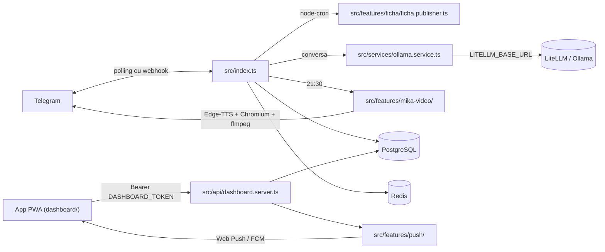

<div align="center">


# 🚀 Queima Buchinho Bot

**Bot de Telegram para motivação de treinos e hábitos, com a IA Mika como assistente.**<br/>
Ficha de treino às 06:00 (seg a sáb), lembretes que conferem o dia e fechamento às 21:30.

[]()
[]()
[]()
[]()
[]()
[]()

<sub>TODO(screenshot): tela principal do app PWA (`dashboard/`) como imagem de destaque.</sub>

</div>

> **Queima Buchinho** é um bot de motivação de treinos e rastreamento de hábitos saudáveis via Telegram, integrado com Inteligência Artificial sob a persona de **Mika** (uma assistente *toxic-cute*, irônica e altamente sarcástica). 
Para começar a interagir e acompanhar seus hábitos, basta iniciar uma conversa com o bot no Telegram e usar o comando /start.
Este projeto demonstra uma aplicação completa de bot Telegram com IA, testes automatizados e deploy via Docker.

Construído com foco em altíssima performance, baixo consumo de memória e inicialização instantânea utilizando o ecossistema **Bun** e **TypeScript**.

## 🧭 Por que existe

Escopo: **um bot de hábitos no Telegram**. O app PWA é opcional e usa a mesma API; o Telegram segue funcionando sem ele.

- **Ficha que não depende da IA**: o treino sai de um catálogo curado; se o LLM estiver fora, a ficha das 06:00 sai mesmo assim, sem a provocação.
- **Lembrete que confere antes de cobrar**: água só quando está abaixo do ritmo do dia, refeição só se ainda não marcada.
- **Pouca mensagem, no horário certo**: manhã em um card só (06:00) e noite concentrada no fechamento das 21:30.

## 🖼️ Tour

> TODO(screenshot): tela principal do app PWA e card da ficha de treino no Telegram. Capturas pendentes: o bot precisa estar rodando com `TELEGRAM_BOT_TOKEN`, Postgres e Redis, com dados fictícios.

---

## ✨ Recursos Principais

- 🏋️ **Ficha de Treino (queima de gordura)**: publicada automaticamente às **06:00 BRT, de segunda a sábado**, com foto do aparelho, nome do exercício, séries/repetições, carga atual e o bloco de cárdio (esteira ou bicicleta). Botões no card ajustam a carga em ±2,5/±5 kg — o valor fica salvo e volta no treino seguinte. Ver seção abaixo.
- 📅 **Rastreamento de Hábitos Diários**: Controle interativo de hábitos como treino, cárdio, alongamento, leitura, meditação, suplementos, refeições e restrição de açúcar.
- 💧 **Registro de Água Simplificado**: Menu rápido para registrar consumo de água ao longo do dia em ml.
- 📈 **Registro de Métricas Corporais**: Acompanhe seu peso, altura, passos diários, gordura corporal e massa muscular com comandos simples.
- 🤖 **Interação Inteligente (Mika)**: Respostas dinâmicas geradas por IA (Ollama ou LiteLLM) com a persona ácida de Mika.
- 🗣️ **Respostas de Voz (TTS)**: Conversão de texto para fala em tempo real integrada utilizando a API Edge-TTS.
- 🎬 **Mika em vídeo**: o fechamento das 21:30 chega como vídeo redondo da Mika (modelo VRM em close, fundo anime, boca sincronizada com a fala). Render em segundo plano; se falhar, vai a voz de sempre. Detalhes em `src/features/mika-video/README.md`.
- 📊 **Relatórios Consolidados**: Resumos diários e relatórios semanais com gráficos de barra gerados diretamente no chat.
- 🔕 **Lembretes que respeitam o que já foi feito**: água só quando está abaixo do ritmo do dia, refeição só se ainda não marcada. Manhã em um card só (bom dia + cardápio + menu, 06:00) e noite concentrada no fechamento das 21:30. Os comandos aparecem no menu "/" do Telegram.
- 📱 **App PWA / Android**: app instalável (`dashboard/`) com todas as funções do Telegram, modo offline e notificações push — ver seção abaixo.
- ⚡ **Execução Resiliente**: Auto-reconnect em caso de falhas de polling e smart liveness check para monitorar a saúde da aplicação.

---

## 🏋️ Ficha de Treino

Substitui a antiga ficha estática. O treino é **determinístico**: o split e os exercícios saem de
um catálogo curado (`src/features/ficha/`), e a IA escreve apenas a provocação da Mika — se o LLM
estiver fora, a ficha das 6h sai do mesmo jeito, sem provocação.

**Protocolo (queima de gordura):** multiarticular primeiro, repetição alta, descanso curto
(40-60 s) e cárdio **depois** da musculação.

| Dia | Treino | Cárdio |
|---|---|---|
| Segunda | Full Body Metabólico A | Esteira — HIIT 1:2 (15 min) |
| Terça | Superior Metabólico | Bicicleta — Z2 (25 min) |
| Quarta | Inferior + Glúteo | Esteira — inclinada 12% (30 min) |
| Quinta | Full Body Metabólico B | Bicicleta — HIIT 30/60 s (15 min) |
| Sexta | Superior + Core | Esteira — intervalado 1:1 (20 min) |
| Sábado | Inferior + Cárdio Longo | Esteira — trote Z2 (35 min) |
| Domingo | descanso — o cron não dispara | — |

**Botões do card:** `🏋️ Treinei` grava em `workout_logs` + hábito `treino` (streak, `/relatorio` e
dashboard continuam corretos), `🏃 Fiz o cárdio` grava o hábito `cardio`, e `⚖️ Ajustar carga` abre
a lista de exercícios e o seletor de ±2,5/±5 kg.

**Tabelas** (criadas por `bun run migrate`):

- `exercise_loads` — carga por exercício e usuário; é ela que faz a progressão de carga.
- `ficha_sessions` — ficha entregue no dia (JSONB) e se treino/cárdio foram concluídos.

Imagens: [free-exercise-db](https://github.com/yuhonas/free-exercise-db) (domínio público, CDN do
GitHub); todas as URLs do catálogo foram verificadas em 200 na geração.

---

## 🛠️ Stack Tecnológica

- **Runtime**: [Bun](https://bun.sh/) (para boot ultra-rápido, testes acelerados e economia de memória)
- **Framework do Bot**: `node-telegram-bot-api`
- **Banco de Dados**: PostgreSQL (armazenamento persistente de treinos, hábitos e métricas)
- **Cache / Estado**: Redis (armazenamento temporário e controle de concorrência)
- **IA/LLM**: Ollama (`ai-sdk-ollama`) e LiteLLM, gateway compatível com OpenAI, via `@ai-sdk/openai-compatible`
- **Agendador**: `node-cron` para a ficha de treino das 6h, notificações de refeições e lembretes diários
- **Testes**: Jest com `ts-jest`

---

## 🔀 Como funciona



- A ficha é determinística: o treino sai do catálogo em `src/features/ficha/catalog.ts`; a IA só escreve a provocação.
- Lembretes conferem o estado do dia antes de enviar (água e refeição).
- A API do app fica desligada sem `DASHBOARD_TOKEN` e exige Bearer em todas as rotas `/api/*`.
- O vídeo da Mika renderiza em segundo plano; se falhar, vai a voz de sempre.

---

## 🎮 Comandos do Bot

Exemplo de uso: `/peso 78,5` registra o peso do dia. Saída não verificada: exige o bot rodando com `TELEGRAM_BOT_TOKEN`.

### 📋 Menu & Controle
- `/menu` | `/start` | `/progresso` — Abre o menu diário interativo de hábitos.
- `/help` — Exibe a lista de comandos e ajuda.
- `/agua` — Atalho para registrar ingestão de água.
- `/semana` — Exibe o relatório de progresso dos hábitos da semana corrente.
- `/relatorio` — Relatório consolidado do dia.
- `/cardapio` — Exibe a dieta/refeição recomendada para o dia atual.
- `/ficha` — Publica a **Ficha de Treino** de hoje (mesma que sai às 6h): imagens dos aparelhos, repetições, cargas e botões.
- `/hora` — Consulta o horário oficial de Brasília.
- `/app` — Envia o link do app e um teste de notificação (usa `APP_URL`).

### 💪 Treino & Streak
- `/checktreino` — Alterna o status do treino de hoje.
- `/cardio` — Alterna o status do cárdio de hoje.
- `/streak` — Exibe quantos dias seguidos você treinou sem falhar.
- `/reset` — Reseta os registros do dia atual.

### 📊 Registro de Métricas
- `/peso [valor]` — Registra seu peso em kg; aceita vírgula ou ponto (ex: `/peso 78,5`). Sem valor, abre botões com opções perto do último peso.
- `/altura <valor>` — Registra sua altura em cm (ex: `/altura 175`).
- `/passos <valor>` — Registra os passos acumulados no dia (ex: `/passos 10000` ou `/passos 10.000`).
- `/gordura <valor>` — Registra o percentual de gordura corporal (ex: `/gordura 14.5`).
- `/musculo <valor>` — Registra o percentual de massa muscular (ex: `/musculo 42.1`).
- Valor ambíguo (`82,5kg`, `1.234,5`) é recusado com um exemplo — nada é gravado pela metade.

### ✍️ Registro rápido (chat privado)
Frases curtas viram registro sem comando: `bebi 500ml`, `tomei 1,5l`, `pesei 82,5`. A resposta traz um botão **↩️ Desfazer**. `treinei` / `fiz cardio` pedem confirmação por botão. Negação ou pergunta (`não treinei`, `bebi 500ml?`) segue para a conversa com a Mika.

### ⏸️ Pausa
- `/pausar [dias]` — De 1 a 30 dias (padrão 1): sem lembretes nem cobranças, e a sequência de treinos fica congelada.
- `/voltar` — Retoma os lembretes antes do fim da pausa.

### 🎭 Diversão & Mídias
- `/motivar` — Solicita uma frase motivacional (ou um deboche) de voz da Mika.
- `/cantada` | `/xaveco` — Envia uma cantada nerd/maromba de academia.
- `/meme <termo>` — Busca um meme de academia (ou termo específico).
- `/sticker <termo>` — Busca um sticker relacionado ao termo.
- `/gif <termo>` — Envia um GIF do Giphy associado ao termo.
- `/instante <som>` — Toca um áudio divertido do MyInstants (ex: `/instante faustao-errou`).

---

## ⚙️ Instalação e Configuração

### 1. Clonar o Repositório
```bash
git clone git@github.com:juninmd/queima-buchinho.git
cd queima-buchinho
```

### 2. Configurar Variáveis de Ambiente
Copie o arquivo `.env.example` para `.env` e preencha as credenciais:
```bash
cp .env.example .env
```

### 3. Rodar localmente via Docker Compose
A forma mais rápida de iniciar o banco de dados PostgreSQL, Redis e o bot localmente:
```bash
docker-compose up --build
```

### 4. Variáveis de ambiente

Os valores ficam só no `.env`, que não vai para o git. Tokens, URLs de banco e chaves não aparecem aqui por segurança.
Variáveis de debug (`MIKA_VIDEO_DEBUG`, `MIKA_VIDEO_STILL`) ficam de fora.

| Variável | Para que serve | Obrigatória / padrão | Exemplo |
|---|---|---|---|
| `TELEGRAM_BOT_TOKEN` (ou `BOT_TOKEN`) | token do bot do Telegram | obrigatória: sem ela o bot não sobe | — |
| `CHAT_ID` ou `USER_ID` | id numérico do dono no Telegram, usado pelo dashboard | padrão `0` | — |
| `DATABASE_URL` | conexão com o PostgreSQL | obrigatória para `migrate` e para os dados | — |
| `REDIS_URL` | cache e estado temporário | opcional: sem ela o cache fica desligado | — |
| `LITELLM_BASE_URL` / `LITELLM_API_KEY` | gateway compatível com OpenAI usado pela Mika | sem elas, as respostas da Mika falham (aviso no log) | — |
| `AI_MODEL` | modelo usado pela Mika | padrão `cloud/auto` | `cloud/auto` |
| `OLLAMA_TIMEOUT_MS` | tempo máximo de uma chamada à IA, em ms | padrão `300000` | `300000` |
| `GIPHY_API_KEY` | busca de mídia no Giphy | sem ela, a busca devolve vazio | — |
| `USER_BIRTHDAY` | aniversário para a mensagem das 09:00 | opcional, `DD/MM` ou `DD/MM/AAAA` | `DD/MM/AAAA` |
| `BOT_MODE` | `listener` recebe mensagens; `checker` roda a checagem diária | padrão `listener` | `listener` |
| `WEBHOOK_URL` | URL pública do bot; se definida, usa webhook em vez de polling | opcional | — |
| `PORT` | porta do webhook | padrão `3000` | `3000` |
| `HEALTH_PORT` | porta do `/health` (também usada no HEALTHCHECK do Dockerfile) | padrão `8080` | `8080` |
| `DASHBOARD_TOKEN` | Bearer da API do app | sem ela, a API do app fica desativada | — |
| `DASHBOARD_PORT` | porta da API e do PWA | padrão `8081` | `8081` |
| `DASHBOARD_CORS_ORIGIN` | origem liberada no CORS | padrão `*` | `https://seu-dominio` |
| `PWA_DIST_DIR` | pasta do build do PWA | padrão `dashboard/dist` | `dashboard/dist` |
| `VAPID_PUBLIC_KEY` / `VAPID_PRIVATE_KEY` / `VAPID_SUBJECT` | chaves do Web Push | opcional: sem elas, o push do PWA responde `push_disabled` | — |
| `FCM_SERVICE_ACCOUNT` | credencial do Firebase para push no app nativo | opcional | — |
| `APP_URL` | link do app enviado pelo `/app` | opcional | — |
| `MIKA_VIDEO` | liga/desliga o vídeo das 21:30; `0`, `off` ou `false` desligam | padrão: ligado se houver Chromium e VRM | `off` |
| `MIKA_VRM_PATH` | modelo VRM da Mika | padrão `assets/mika/mika.vrm` | `assets/mika/mika.vrm` |
| `MIKA_VIDEO_TIMEOUT_MS` | tempo máximo do render do vídeo, em ms | padrão `1200000` (20 min) | `1200000` |
| `CHROMIUM_PATH` | executável do Chromium para o render | opcional; a imagem Docker define `/usr/bin/chromium` | `/usr/bin/chromium` |

---

## 📱 App PWA (Android, iOS e desktop)

App instalável em `dashboard/` (React + Vite) que faz tudo o que o bot faz no Telegram: hábitos,
água, medidas, ficha de treino com ajuste de carga, cardápio, pausa, progresso com gráficos e a Mika
(chat, áudio, memes, GIFs). Funciona offline (fila de sincronização) e recebe lembretes por push.
O bot serve o app na mesma porta da API, sem CORS nem token no bundle.

```bash
# 1. .env do bot
DASHBOARD_TOKEN=algum-token-secreto
DASHBOARD_PORT=8081
# 2. build do app (a imagem Docker já faz isso) e subir o bot
cd dashboard && bun install && bun run build && cd .. && bun run start
# 3. abra https://seu-dominio no celular, informe o token e "Adicionar à tela inicial"
```

Mapa de telas ↔ comandos, push (VAPID), build Android (TWA/Bubblewrap) e contrato da API:
[`docs/pwa/README.md`](docs/pwa/README.md) e [`docs/pwa/API.md`](docs/pwa/API.md).

## 🛡️ Diretrizes do Protocolo Antigravity

Este projeto segue regras de codificação do protocolo **Antigravity**:
1. **Limite de 150 Linhas por Arquivo**: Módulos e classes devem ser fragmentados para manter a legibilidade e a separação de responsabilidades.
2. **Tipagem Estrita**: Nenhuma utilização de tipo `any` sem justificativa excepcional.
3. **Robustez e Cobertura**: Garantia de cobertura de testes abrangendo cenários felizes e de erro (edge cases).

---

## 🧪 Desenvolvimento & Testes

Para executar testes locais utilizando o runtime do Bun:

```bash
bun install --frozen-lockfile   # dependências, pelo bun.lock (como no Dockerfile)
bun run migrate                 # cria as tabelas no DATABASE_URL
bun run dev                     # bot com hot reload (bun --hot src/index.ts)
bun run start                   # bot sem hot reload (bun src/index.ts)
bun run test                    # testes unitários e integrados com Jest
bun run lint                    # tsc --noEmit: validação de tipagem do TypeScript
cd dashboard && bun install --frozen-lockfile && bun run build   # PWA em dashboard/dist
```

## 🤝 Contribuindo

- Commits seguem [Conventional Commits](https://www.conventionalcommits.org/pt-br/), como `feat(pwa): ...` e `chore(deps): ...` no histórico.
- Regras de código (máximo de 150 linhas por arquivo, tipagem estrita, testes e lint verdes) estão em [`AGENTS.md`](AGENTS.md).
- Pull requests seguem o [template](.github/pull_request_template.md).

## 📚 Documentação

| Documento | O que tem |
|---|---|
| 📱 [App PWA](docs/pwa/README.md) | telas, equivalência com o Telegram, push e build |
| 🔌 [API do app](docs/pwa/API.md) | rotas `/api/*`, autenticação e códigos de erro |
| 📲 [App nativo](docs/pwa/NATIVE.md) | casca Capacitor e push via FCM |
| 🎬 [Mika em vídeo](src/features/mika-video/README.md) | render do fechamento das 21:30 |

## 🔐 Segurança

- Tokens, URLs de banco e chaves ficam só no `.env`, que está no `.gitignore`. O `.env.example` é o modelo a copiar.
- A API do app exige `Authorization: Bearer` com `DASHBOARD_TOKEN` em todas as rotas `/api/*`.
- O workflow `security.yml` roda o gitleaks. Para reportar vulnerabilidades, veja o [SECURITY.md](SECURITY.md).

## ⚠️ Limitações conhecidas

- Depende de serviços externos: Telegram, o LLM (LiteLLM ou Ollama), Giphy, MyInstants e o TTS do Edge. Sem o LLM, as respostas da Mika falham, mas a ficha das 06:00 sai sem a provocação.
- O vídeo da Mika precisa de Chromium, ffmpeg e do modelo VRM. Sem eles, o fechamento das 21:30 vai só em voz.
- Os horários são fixos no fuso de Brasília (`America/Sao_Paulo`).

## 📄 Licença

MIT, conforme o campo `license` do [`package.json`](package.json). O repositório ainda não traz o arquivo `LICENSE`.
